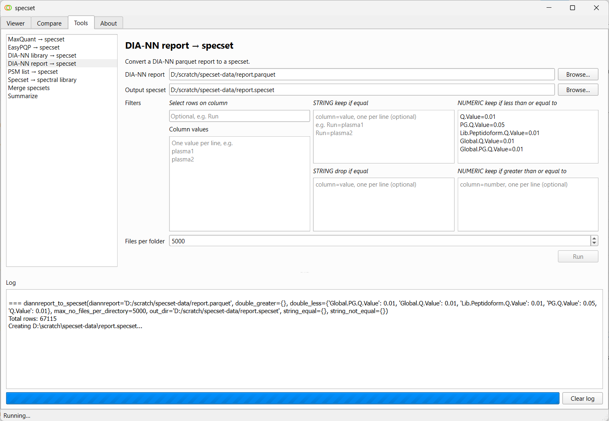
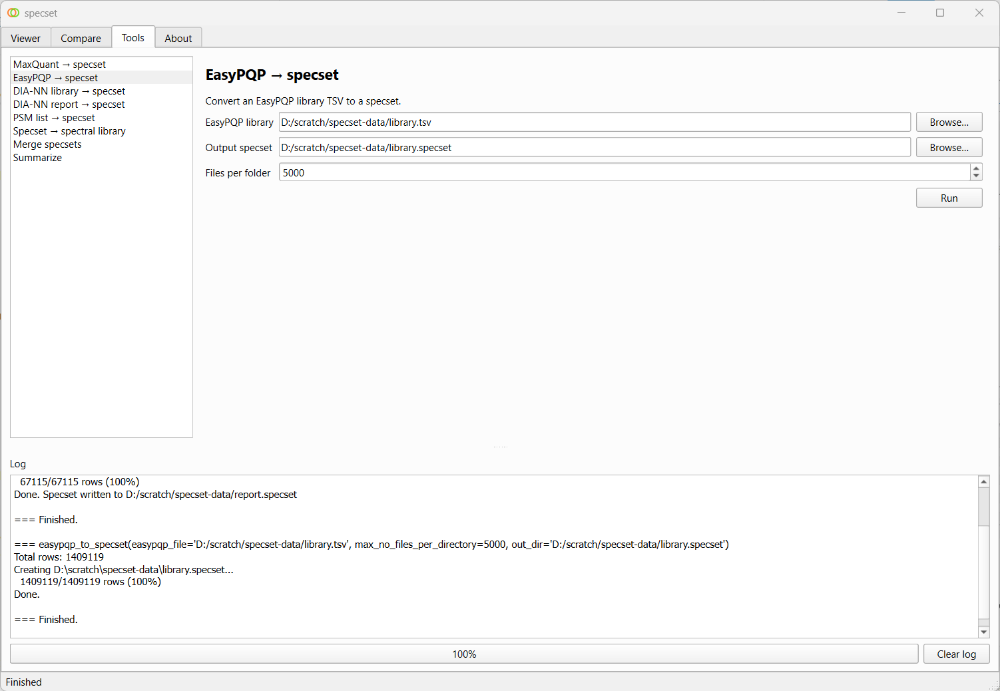
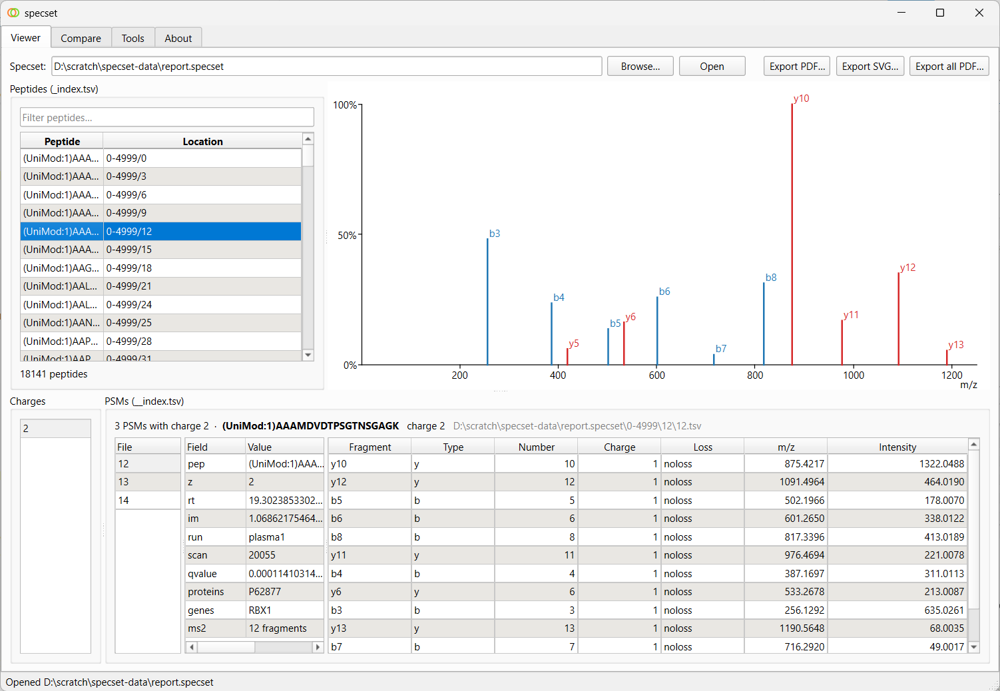
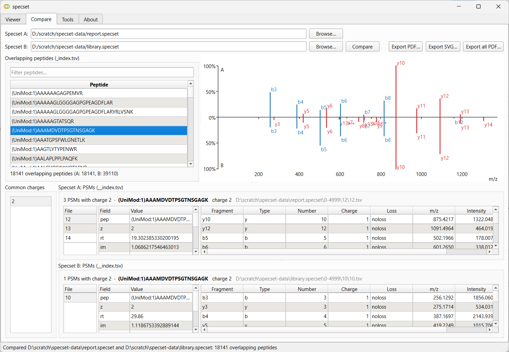
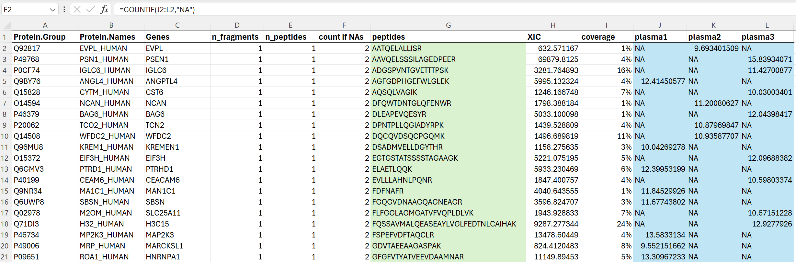
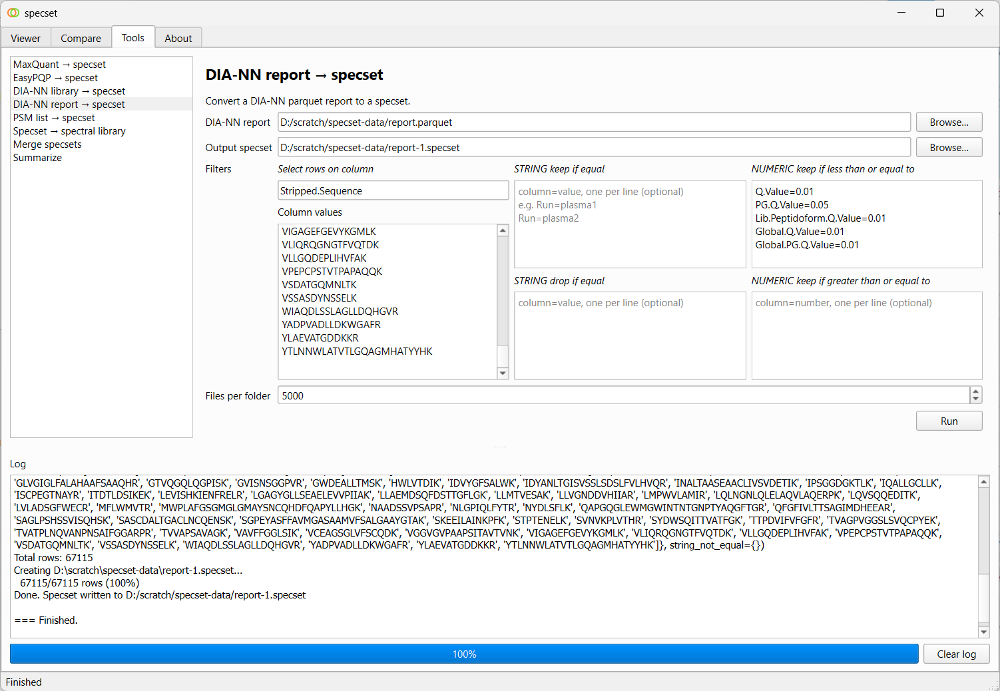
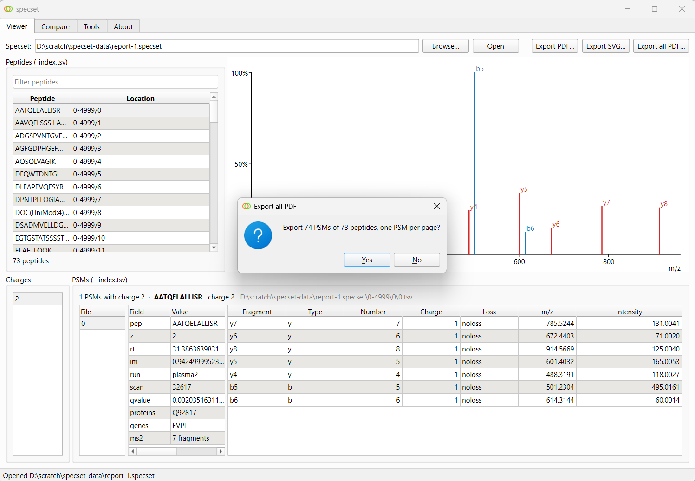

# specset

<p align="center">

</p>

<div align="center">

**A lightweight toolkit for manipulation of peptide spectrum matches in mass spectrometry-based proteomics**

</div>

## Installation
Create a Python enviroment and install specset using pip

### Windows
On Windows, we have tested with the official Python distribution Python 3.12.9 at [https://www.python.org/downloads/windows/](https://www.python.org/downloads/windows/). At the moment, AlphaPeptDeep does not work with a newer Python version. Open a command prompt from a working directory
```
python -m venv venv_specset

venv_specset\Scripts\activate.bat

pip install specset[full]
```
The ```full``` installation includes a GUI application. 

### Linux
On Linux, the installation is as follows.
```
python -m venv venv_specset

. venv_specset/bin/activate

pip install specset[full]
```

For the GUI application, one some Linux systems, the user has to install extra system libraries

```
sudo apt install libxcb-cursor0
```

or

```
sudo apt install libxcb-xinerama0 libxcb-icccm4 libxcb-image0 libxcb-keysyms1 libxcb-randr0 libxcb-render-util0 libxcb-xkb1 libxkbcommon-x11-0
```


For experiments with AlphaPeptDeep, installation of the AlphaPeptDeep ecosystem is needed.

```
pip install "alphabase[full-stable]"
pip install "peptdeep[stable,gui-stable]"
```

## Usage

Follow examples in the notebooks or check the command line usage.

```
specset --help
```

 The following two command lines import a MaxQuant search output txt folder into a specset and export the specset to a spectral library

```
specset maxquant_to_specset --additional-column Score=score --additional-column Proteins=proteins --additional-column "Gene Names"=genes txt txt.specset

specset specset_to_speclib --additional-column proteins=Protein.Ids --additional-column genes=Genes --consensus-method score txt.specset txt.specset.lib.tsv
```

## GUI application

The application can be started by executing the command

```
specset-gui
```

The application features four tabs: Viewer, Compare, Tools, and About. The Viewer tab allows users to browse a single specset. The Compare tab highlights the differences between two spec sets. The Tools tab directly maps to the available shell commands. Finally, the About tab displays components of the application.

There is a prebuilt application for Windows 11 in Releases.

The following example visualizes the result of a DIA-NN search result using a experimental library.

### Creating specsets

First, go to the **Tools** tab, select **DIA-NN report &rarr; specset**, browse to your DIA-NN result file report.parquet (```--export-quant``` must be included in the DIA-NN search), fill out the desired filters, and enter output file, for example, report.specset, then click Run.

<div align="center">

</div>

Next, convert a spectral library obtained from Fragpipe pipeline to specset. Select **EasyPQP &rarr; specset**, browse to your library file, enter output filename, for example, library.specset, then click Run.

<div align="center">

</div>

### Exploring a specset

You can explore the created specsets. Go to the **Viewer** tab, browse to a specset, then click Open.

<div align="center">

</div>

### Comparing two specsets

To compare a detected spectrum versus the library spectrum, Go to the **Compare** tab, browse to the two specsets (for performance, select the smaller one first), then click Compare.

<div align="center">

</div>

### Export to PDF

If you want to generate a PDF report of all proteins identified by a single peptide in a single run, you can use R or Excel to compile the peptide list. In this example, the Excel COUNTIF function was used to count the number of missing values (NAs) across a dataset of 3 samples. We then filtered for rows where the peptide count is one (n_peptides = 1) and the number of NAs is 2.

<div align="center">

</div>

In **DIA-NN report &rarr; specset**, use ```Stripped.Sequence``` under ``` Select rows on column```, and copy and paste your selected peptides into the ```Column values```  to generate a specset.

<div align="center">

</div>

Go to the **Viewer** tab, open the newly created specset, then click ```Export all PDF...```.

<div align="center">

</div>

There may be more PSMs than peptides because a single peptide can be identified in multiple charge states.